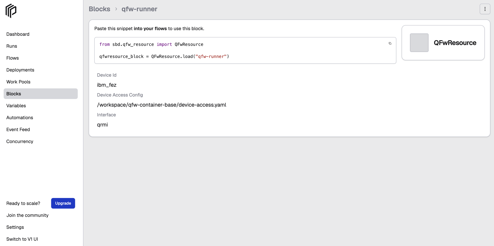

# Create and Register a QFw Resource Block

The `QFwResource` Prefect block stores the configuration needed to access a quantum device through QFw.

Use this block when the SQD workflow is configured with:

```text
quantum_source = "qfw"
```

## 1. Prerequisites

Before creating the `QFwResource` block:

- The QFw-SLURM container environment must be running.
- QFw and QRMI must already be configured for the target quantum device.
- The QFw device-access configuration and provider credentials must be available in the QFw-SLURM environment.
- A Prefect server must be running and the active Prefect profile must point to that server.
- The `qcsc-prefect` repository must be available in the active QFw-SLURM environment.

For QFw device and provider credential setup, see the [QFw device configuration](howto_setup_qfw_device_configuration.md).

For Prefect server setup in the QFw-SLURM environment, see [How to Run and Access a Prefect Server on a Slurm Login Node](howto_setup_prefect_server_slurm.md).

## 2. Register the QFw Resource Block Type

The `QFwResource` block contains the information needed to locate and access a QFw device resource.

The block is part of the `qcsc-prefect-qiskit` package:

```text
/path/to/qcsc-prefect/packages/qcsc-prefect-qiskit/src/qcsc_prefect/integrations/qiskit/sources/qfw_resource.py
```

The former import path `sbd.qfw_resource.QFwResource` still works and gives the same
class, so saved `qfwresource` blocks keep loading.

Register the block type with Prefect:

```bash
python - <<'PY'
from qcsc_prefect.integrations.qiskit.sources import QFwResource

QFwResource.register_type_and_schema()
print("QFwResource registered")
PY
```

A successful registration prints:

```text
QFwResource registered
```

Verify that the block type is registered:

```bash
prefect block type ls | grep -i qfw
```

The output should include `QFwResource`.

> **Note**
>
> Importing or loading `QFwResource` does not import QFw or DEFw: they are imported only
> by the block's QFw methods, such as `run_circuit`. This matters because DEFw installs
> signal handlers on import, which Python allows only in the main thread, while Prefect
> loads block files and runs tasks in worker threads. The block can therefore be
> registered with `prefect block register -m qcsc_prefect.integrations.qiskit.sources`
> as well as with the Python snippet above. Do not call its QFw methods from a worker
> thread; the SQD workflow uses only the saved `device_id`, through `QFwSource`.
>
> `QFwResource.run_sampler` is deprecated: it filters the shots inside the block and
> loses leading zeros. Use `QFwSource`, which returns every register, and filter in the
> application. See [Quantum Sources](howto_use_quantum_source.md).

## 3. Create the QFw Resource Block Instance

Create the `qfw-runner` block instance by specifying the QFw device ID and the device-access configuration file.

From the `qcsc-prefect` repository root, run:

```bash
python algorithms/closed_loop/sqd_de/create_qfw_block.py \
  --device-id <device-id> \
  --device-access-config <path-to-device-access.yaml>
```

For example:

```bash
python algorithms/closed_loop/sqd_de/create_qfw_block.py \
  --device-id ibm_fez \
  --device-access-config /workspace/qfw-container-base/device-access.yaml
```

The value passed to `--device-id` must correspond to a device configured under `qpus` in the specified `device-access.yaml` file.

If `--device-access-config` is omitted, the script uses the following default path:

```text
/workspace/qfw-container-base/device-access.yaml
```

For example, when using the default configuration path:

```bash
python algorithms/closed_loop/sqd_de/create_qfw_block.py \
  --device-id ibm_fez
```

A successful creation prints output similar to:

```text
Created QFwResource block: qfw-runner
Device ID: ibm_fez
```

The created block uses the QRMI interface for QFw device access and quantum execution.


## 4. Verify the Block Instance

Check that the named block instance was created:

```bash
prefect block ls
```
The block should appear with the name `qfw-runner`:

```text
                                           Blocks
┏━━━━━━━━━━━━━━━━━━━━━━━━━━━━━━━━━━━━━━┳━━━━━━━━━━━━━┳━━━━━━━━━━━━┳━━━━━━━━━━━━━━━━━━━━━━━━┓
┃ ID                                   ┃ Type        ┃ Name       ┃ Slug                   ┃
┡━━━━━━━━━━━━━━━━━━━━━━━━━━━━━━━━━━━━━━╇━━━━━━━━━━━━━╇━━━━━━━━━━━━╇━━━━━━━━━━━━━━━━━━━━━━━━┩
│ <block_id>                           │ QFwResource │ qfw-runner │ qfwresource/qfw-runner │
└──────────────────────────────────────┴─────────────┴────────────┴────────────────────────┘
```

Inspect the block instance:

```bash
prefect block inspect qfwresource/qfw-runner
```

The output should look similar to:

```text
                                                        qfwresource/qfw-runner
┌─────────────────────────────────────────┬──────────────────────────────────────────────────────────────────────────────────────────┐
│ Block Type                              │ QFwResource                                                                              │
│ Block id                                │ <block_id>                                                                               │
├─────────────────────────────────────────┼──────────────────────────────────────────────────────────────────────────────────────────┤
│ device_id                               │ ibm_fez                                                                                  │
│ device_access_config                    │ /workspace/qfw-container-base/device-access.yaml                                         │
│ interface                               │ qrmi                                                                                     │
└─────────────────────────────────────────┴──────────────────────────────────────────────────────────────────────────────────────────┘

```

The block details should show the configured device ID, device-access configuration path and interface.

You can also view and edit the block configuration from the Prefect UI under `Blocks`.



