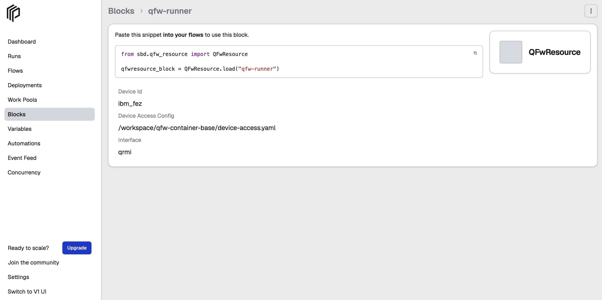

# Create and Register a QFw Resource Block

The `QFwResource` Prefect block stores the configuration needed to access a quantum device through QFw.

Use this block when the SQD workflow is configured with:

```text
quantum_source = "qfw"
```

## 1. Prerequisites

Before creating the `QFwResource` block:

- The QFw-SLURM container environment must be running.
- QFw and QRMI must already be configured for the target quantum device.
- The QFw device-access configuration and provider credentials must be available in the QFw-SLURM environment.
- A Prefect server must be running and the active Prefect profile must point to that server.
- The `qcsc-prefect` repository must be available in the active QFw-SLURM environment.

For QFw device and provider credential setup, see the [QFw device configuration](howto_setup_qfw_device_configuration.md).

For Prefect server setup in the QFw-SLURM environment, see [How to Run and Access a Prefect Server on a Slurm Login Node](howto_setup_prefect_server_slurm.md).

## 2. Register the QFw Resource Block Type

The `QFwResource` block contains the information needed to locate and access a QFw device resource.

The block implementation is located at:

```text
/path/to/qcsc-prefect/algorithms/sbd/sbd/qfw_resource.py
```
Register the block type with Prefect from the `qcsc-prefect` repository root::

```bash
python - <<'PY'
from sbd.qfw_resource import QFwResource

QFwResource.register_type_and_schema()
print("QFwResource registered")
PY
```

A successful registration prints:

```text
QFwResource registered
```

Verify that the block type is registered:

```bash
prefect block type ls | grep -i qfw
```

The output should include `QFwResource`.

> **Note**
>
> Do not use `prefect block register -f` for `qfw_resource.py`. Prefect loads block files in a worker thread, while QFw initializes DEFw during import. DEFw installs signal handlers, which Python only permits from the main interpreter thread. Registering the block type through Python, as shown above, ensures that the QFw module is imported from the main thread.


## 3. Create the QFw Resource Block Instance

Create and save the `qfw-runner` block instance using:

```bash
python /path/to/qcsc-prefect/algorithms/sbd/create_qfw_block.py
```
The default QFw resource configuration is:

| Parameter | Default value |
|---|---|
| `device_id` | `ibm_fez` |
| `device_access_config` | `/workspace/qfw-container-base/device-access.yaml` |
| `interface` | `qrmi` |

Update these values if your QFw-SLURM environment uses a different device, configuration path or interface library.

## 4. Verify the Block Instance

Check that the named block instance was created:

```bash
prefect block ls
```
The block should appear with the name `qfw-runner`.

```text
                                           Blocks
┏━━━━━━━━━━━━━━━━━━━━━━━━━━━━━━━━━━━━━━┳━━━━━━━━━━━━━┳━━━━━━━━━━━━┳━━━━━━━━━━━━━━━━━━━━━━━━┓
┃ ID                                   ┃ Type        ┃ Name       ┃ Slug                   ┃
┡━━━━━━━━━━━━━━━━━━━━━━━━━━━━━━━━━━━━━━╇━━━━━━━━━━━━━╇━━━━━━━━━━━━╇━━━━━━━━━━━━━━━━━━━━━━━━┩
│ <block_id>                           │ QFwResource │ qfw-runner │ qfwresource/qfw-runner │
└──────────────────────────────────────┴─────────────┴────────────┴────────────────────────┘
```
You can see it on the Prefect UI under `Blocks`



The block details should show the configured device ID, device-access configuration path and interface.You can also edit the block configuration from the Prefect UI by selecting the three-dot menu on the right.


