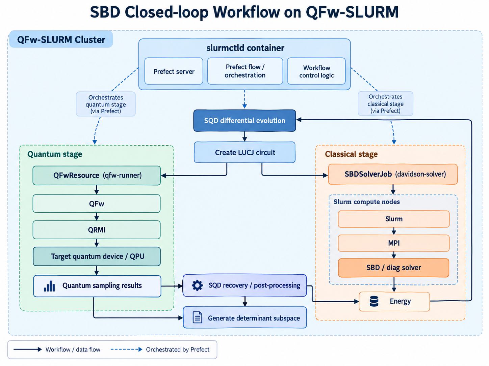
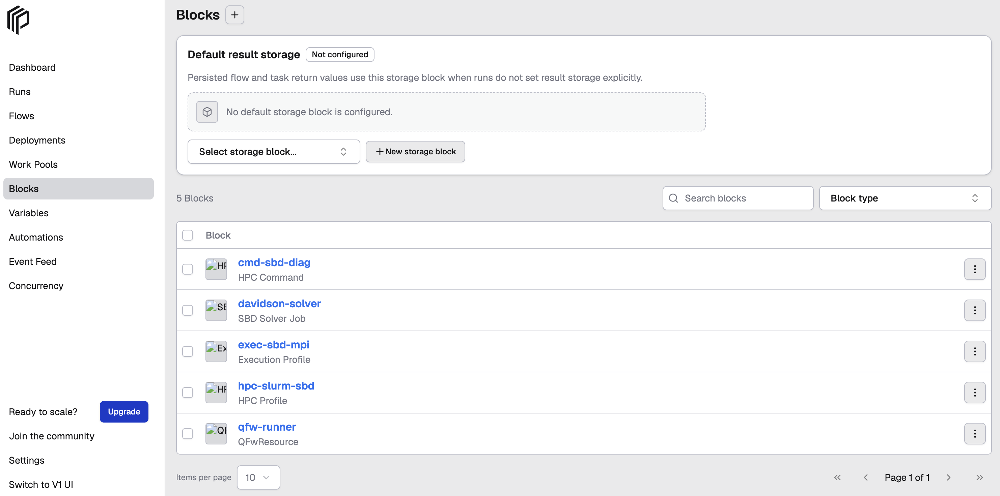
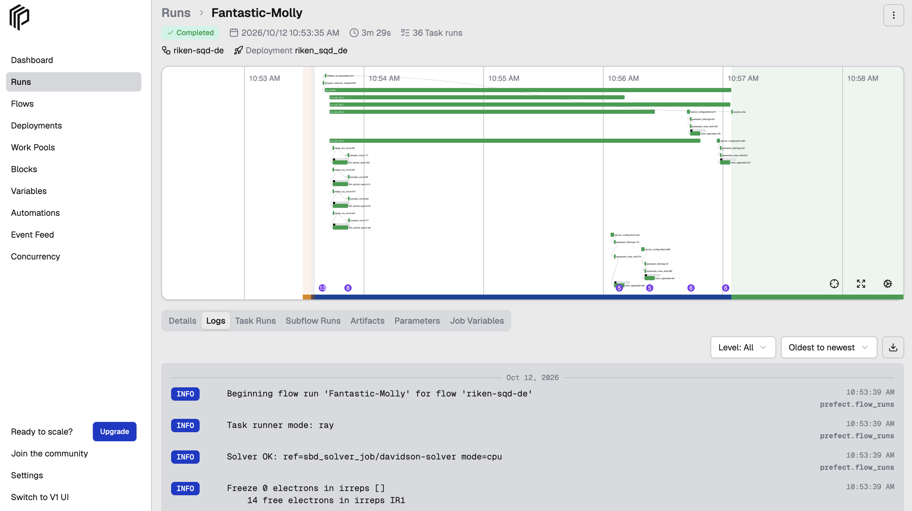
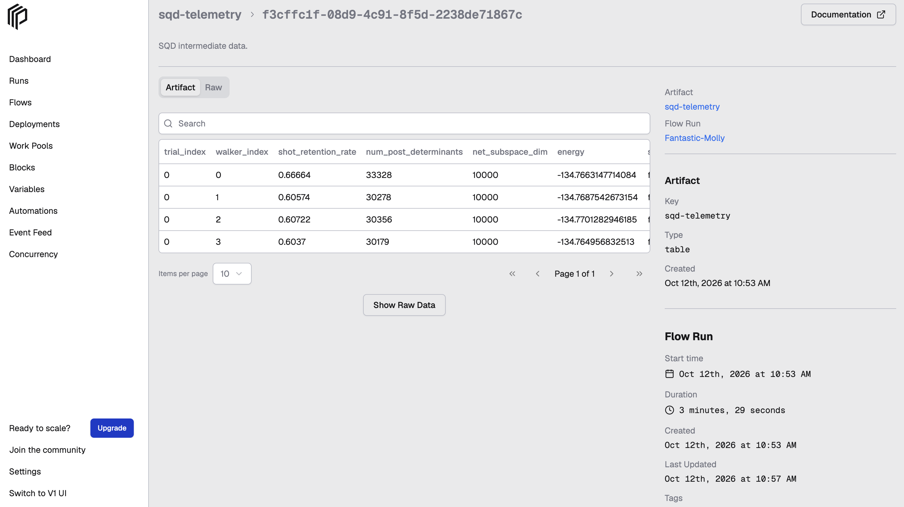

# Run the SQD Closed-loop Workflow with SBD on QFw-SLURM (qcsc-prefect)

This tutorial demonstrates a Sample-based Quantum Diagonalization (SQD) workflow with the [SBD solver](https://github.com/r-ccs-cms/sbd) in a [QFw-SLURM](https://github.com/openQSE/QFw-SLURM-Cluster#readme) environment. The workflow combines quantum sampling with classical processing and uses SBD to diagonalize a sparse chemistry Hamiltonian in the `QFw-SLURM` environment, with Prefect orchestrating the end-to-end workflow.

For the example in this tutorial, the goal is to compute the ground-state energy of the N₂ molecular system using the SQD workflow.

[QFw](https://github.com/openQSE/QFw) is a quantum execution framework for running quantum applications against simulator or hardware services. It provides the quantum execution infrastructure used by this workflow, while [QFw-SLURM](https://github.com/openQSE/QFw-SLURM-Cluster#readme) provides a containerized Slurm environment in which QFw applications and classical HPC workloads can be executed.

The `qcsc-prefect` repository is installed and executed inside this environment and provides the Prefect workflow, SQD application logic and orchestration between the quantum and classical stages.

The workflow combines:

- Prefect for end-to-end workflow orchestration
- [QFw](https://github.com/openQSE/QFw) with the [QRMI](https://github.com/qiskit-community/qrmi) library interface for quantum resource access and execution
- Slurm for classical HPC job scheduling
- MPI and SBD for Davidson diagonalization

In this workflow, SQD defines the overall quantum-classical workflow, while SBD provides the classical Davidson diagonalization used to evaluate the determinant subspace.

> **Note**
>
> This tutorial assumes that a QFw-SLURM environment has already been installed and is running. QFw and QFw-SLURM are maintained separately from `qcsc-prefect`; this tutorial focuses on configuring and running `qcsc-prefect` within that environment. As a next step, we plan to integrate the `qcsc-prefect` software environment more directly into QFw-SLURM to simplify setup and deployment.

## Prerequisites

Before starting, make sure that:

- Docker is installed and available on the host system.
- You can access the [QFw-SLURM](https://github.com/openQSE/QFw-SLURM-Cluster#readme) repository.
- You have valid provider credentials for submitting jobs to the target quantum device.
- The host system has sufficient resources to run the QFw-SLURM environment.

The tutorial will cover creating and starting the QFw-SLURM environment, configuring QFw access to the quantum device, setting up Prefect and running the SQD workflow.

> **Validated environments**
>
> This tutorial has been validated with QFw-SLURM commit `c05469901d7efc46bdf98ba8b5944f63df4c560c` in the following environments:
>
> - macOS host with ARM64/AArch64
> - Linux/x86_64


## Workflow architecture

With `quantum_source="qfw"`, the SQD workflow uses QFw and QRMI for quantum execution and Slurm/MPI for the classical SBD stage.



<p align="center">
  <em>QFw-SLURM execution architecture for the SQD workflow.</em>
</p>

For the quantum stage, the SQD workflow uses the QFw QPU front-end and the QRMI library interface to access and execute workloads on the configured quantum device. In this path, the workflow calls QFw/QRMI directly; it does not submit the quantum workload through Slurm or generate an `sbatch` script.

The classical SBD stage uses a separate execution path. `SBDSolverJob` submits the diagonalization workload through Slurm, where `sbatch`/`srun` and MPI are used to launch the SBD solver on the compute nodes.

The workflow obtains the target quantum system through QFw, prepares and transpiles the LUCJ circuit for that target and submits the quantum workload through QFw and QRMI.

The classical stage continues to use the generic Slurm execution support provided by `qcsc-prefect`.

A typical QFw-SLURM setup contains three execution contexts:

- `slurmctld` container — runs the Prefect server, Prefect workflow logic and QFw/QRMI client-side execution.
- Slurm compute nodes — run the compiled SBD `diag` executable through MPI.
- Quantum device — receives sampling workloads through the QFw front-end and QRMI library interface.

The `slurmctld` container acts as the workflow/control environment for this tutorial. The repository and workflow files should be located in a filesystem shared with the Slurm compute nodes.


## SQD closed-loop workflow

The SQD workflow uses differential evolution to optimize the LUCJ parameters. For each differential-evolution iteration, multiple SQD walkers are launched in parallel using Ray.

Each walker performs the following stages:

1. Build the LUCJ circuit for the current parameter set.
2. Execute quantum sampling through QFw and QRMI on the configured quantum device.
3. Perform SQD post-processing and construct the determinant subspace.
4. Run the SBD solver through Slurm and MPI.
5. Return the resulting energy and carryover information to the differential-evolution workflow.

After all walker results are collected, differential-evolution selection updates the LUCJ population and begins the next iteration. The loop continues for the configured number of iterations, after which the workflow reports the best energy found.

Conceptually, the workflow is:

```text
Read FCIDUMP
     |
     v
Initialize LUCJ population
     |
     v
Differential Evolution loop
     |
     +-- Mutation / crossover
     |
     +-- Launch SQD walkers with Ray
     |      |
     |      v
     |   Build LUCJ circuit
     |      |
     |      v
     |   Quantum sampling
     |   QFw -> QRMI -> QPU
     |      |
     |      v
     |   SQD post-processing
     |      |
     |      v
     |   Determinant subspace
     |      |
     |      v
     |   SBD solver
     |   Slurm -> MPI -> SBD
     |      |
     |      v
     |   Energy + carryover state
     |
     +-- Collect walker results
     +-- DE selection
     +-- Update LUCJ population
             |
             +-- next iteration
                    |
                    v
             Final best energy
```

The key feedback path is the energy returned by the SBD solver. After all walker results are collected, differential-evolution selection uses these energies to update the LUCJ population for the next iteration. In this way, the quantum sampling and classical SBD stages form a closed optimization loop rather than a sequence of independent workflow steps.

## 2. Tutorial steps

### Step 1. Create and start the QFw-SLURM environment

Set up the QFw-SLURM environment according to the instructions provided by the [QFw-SLURM](https://github.com/openQSE/QFw-SLURM-Cluster#readme) (`QFw-SLURM-Cluster`) repository.

Before starting the containers, make sure that the `slurmctld` service publishes port `4200` so that the Prefect UI can be accessed from the host machine.

In the QFw-SLURM `docker-compose.yml`, check for:

```yaml id="9lzn1u"
ports:
  - "4200:4200"
```

under the `slurmctld` service.

If the mapping is not already present, add it before creating the containers.

Start the QFw-SLURM environment using the procedure provided by the QFw-SLURM repository.

Verify that the containers are running:

```bash id="5uxpyb"
docker ps
```

Verify that port `4200` is published for `slurmctld`:

```bash id="2793w6"
docker port slurmctld
```

The output should include a mapping similar to:

```text id="jy98c0"
4200/tcp -> 0.0.0.0:4200
```

Next, verify the Slurm cluster from the `slurmctld` container:

```bash id="21clg9"
sinfo
```

A working QFw-SLURM environment should show the configured Slurm partitions and available nodes. For example:

```text id="2qjntz"
PARTITION      AVAIL  TIMELIMIT  NODES  STATE NODELIST
normal*            up 5-00:00:00      8   idle c[1-8]
qfw-services       up 1-00:00:00      8   idle aws,fake-iqm-head,ibm-156-nh,iqm-head,nwqsim-head,nwqsim-worker-[1-2],shim-head
```

The exact partitions, node names and node counts may differ depending on the QFw-SLURM configuration.

### Step 2. Enter the `slurmctld` container and activate the QFw environment

From the host running the QFw-SLURM environment, enter the `slurmctld` container:

```bash
docker exec -it \
  -w /workspace/qfw-container-base \
  slurmctld bash
```

Activate the QFw Python environment:

```bash
source /opt/openqse/qfw/bin/qfw-activate \
  --venv /opt/openqse/qfw-venv
```

Verify that the expected Python environment is active:

```bash
which python
python --version
```

The Python executable should resolve from the QFw virtual environment, for example:

```text
/opt/openqse/qfw-venv/bin/python
```

### Step 3. Set up the `qcsc-prefect` Python environment

From the shared QFw-SLURM workspace, clone the `qcsc-prefect` repository:

```bash
cd /workspace/qfw-container-base

git clone https://github.com/qiskit-community/qcsc-prefect.git
cd qcsc-prefect
```
From the repository root, install the local packages:

``` bash
uv pip install --no-deps \
  -e packages/qcsc-prefect-core \
  -e packages/qcsc-prefect-adapters \
  -e packages/qcsc-prefect-blocks \
  -e packages/qcsc-prefect-executor
```

Install the workflow utility and SBD packages into the active QFw environment:

```bash
uv pip install -e algorithms/qcsc_workflow_utility
uv pip install -e algorithms/sbd
```

Check the installation:

``` bash
uv pip list | grep -E "(qcsc-prefect|sbd|qcsc)"

qcsc-prefect-adapters              0.2.5
qcsc-prefect-blocks                0.2.5
qcsc-prefect-core                  0.2.5
qcsc-prefect-executor              0.2.5
qcsc-workflow-utility              0.1.0
sbd                                0.1.0

```

Verify that Prefect is available from the active QFw virtual environment:

```bash
which prefect
prefect version
```

The Prefect executable should resolve from the QFw virtual environment.

> **ARM/aarch64 note**
>
> Some QFw-SLURM environments may run on ARM/aarch64. If `ffsim` fails at runtime with an `Illegal instruction` error, rebuild the installed `ffsim` version from source for the local CPU architecture:
>
> ```bash
> uv pip install \
>   --reinstall \
>   --no-deps \
>   --no-binary ffsim \
>   "ffsim==0.0.84"
> ```
>
> This workaround is environment-specific and is not required by the SQD workflow itself.


### Step 4. Configure QFw access to the quantum device

Configure QFw and QRMI for the target quantum device, including the device-access configuration and the provider credentials used for quantum job submission.

See the [QFw device configuration](../howto/howto_setup_qfw_device_configuration.md) for details.

Before continuing, verify that the required QFw device configuration and provider credentials are available in the QFw-SLURM environment.

### Step 5. Set up Prefect and the `QFwResource` block

Before running the workflow:

1. Start and configure the Prefect server in the QFw-SLURM environment.

   See the [Prefect server setup for Slurm](../howto/howto_setup_prefect_server_slurm.md) guide for details.

2. Register and create the `QFwResource` block used by the SQD workflow.

   See the [QFw Prefect resource block setup](../howto/howto_setup_qfw_resource_block.md) guide for details.


### Step 6. Build the SBD solver for the QFw-SLURM compute environment

The native SBD executable must be built for the architecture and software environment used by the Slurm compute nodes.

From the qcsc-prefect repository root, navigate to:

```bash
cd algorithms/sbd/native
```

Build the solver using the Slurm build script:

```bash
bash build_sbd_slurm.sh
```

Verify that the executable was created successfully:

```bash
ls -lh diag
file diag
```

The reported executable architecture must be compatible with the Slurm compute nodes on which the SBD solver will run.

Record the absolute path to the executable:

```bash
realpath diag
```

### Step 7. Create the Slurm SBD configuration

Create the Slurm configuration that defines where the SBD solver runs and how the MPI-based classical stage is launched in the QFw-SLURM environment.

Create a working directory accessible from the Slurm compute nodes:

```bash
mkdir -p /path/to/sbd_jobs
```

Create the local Slurm configuration:

```bash
cp /path/to/qcsc-prefect/algorithms/sbd/sbd_blocks.slurm.example.toml \
   /path/to/qcsc-prefect/algorithms/sbd/sbd_blocks.toml
```

Edit the configuration:

```bash
vim /path/to/qcsc-prefect/algorithms/sbd/sbd_blocks.toml
```

Configure the target for the QFw-SLURM environment.

| Parameter | Example | Description |
|---|---|---|
| `hpc_target` | `"slurm"` | Selects the Slurm backend |
| `project` | `"default"` | Slurm account/project, if required |
| `queue` | `"normal"` | Slurm partition |
| `work_dir` | `"/path/to/sbd_jobs"` | Shared job working directory |
| `sbd_executable` | `"/path/to/qcsc-prefect/algorithms/sbd/native/diag"` | Absolute path to the compiled solver |

A minimal configuration looks like:

``` toml
hpc_target = "slurm"
project = "default"
queue = "normal"
work_dir = "/path/to/sbd_jobs"
sbd_executable = "/path/to/qcsc-prefect/algorithms/sbd/native/diag"

launcher = "srun"
walltime = "00:15:00"
num_nodes = 1
mpiprocs = 8
modules = []
mpi_options = []
```

The example configuration also exposes SBD solver parameters:

``` toml
task_comm_size = 1
adet_comm_size = 1
bdet_comm_size = 1

block = 4
iteration = 1
tolerance = 0.01
carryover_ratio = 0.1
solver_mode = "cpu"
```

Here, `iteration` controls the SBD solver iteration count and is separate from the differential-evolution iterations configured for the SQD workflow.

For a quick functional test, the low-iteration settings in the example configuration are recommended before scaling the calculation.

### Step 8. Generate the Prefect Blocks

Use the Slurm SBD configuration created in the previous step to create the reusable Prefect blocks used by the classical stage of the workflow.

Create the classical execution blocks:

```bash
python /path/to/qcsc-prefect/algorithms/sbd/create_blocks.py \
  --config /path/to/qcsc-prefect/algorithms/sbd/sbd_blocks.toml
```

The script creates the reusable configuration needed by `SBDSolverJob`
including:

-   a `CommandBlock` for the `diag` executable
-   an `ExecutionProfileBlock` for MPI/Slurm execution
-   an `HPCProfileBlock` with `hpc_target="slurm"`
-   an `SBDSolverJob`
-   the SQD runtime options Prefect Variable

If you use the block-name overrides shown in the Slurm example
configuration, the resulting names are:

``` text
CommandBlock:          cmd-sbd-diag
ExecutionProfileBlock: exec-sbd-mpi
HPCProfileBlock:       hpc-slurm-sbd
SBD Solver Job:        davidson-solver
Prefect Variable:      sqd_options
```

The `davidson-solver` block is the workflow-facing solver preset.
Internally, it references the command, execution profile and HPC profile blocks.

You can inspect the registered blocks with Prefect:

``` bash
prefect block ls
```
The output should include the following blocks:

```text
┏━━━━━━━━━━━━━━━━━━━━━━━━━━━━━━━━━━━━━━┳━━━━━━━━━━━━━━━━━━━┳━━━━━━━━━━━━━━━━━┳━━━━━━━━━━━━━━━━━━━━━━━━━━━━━━━━┓
┃ ID                                   ┃ Type              ┃ Name            ┃ Slug                           ┃
┡━━━━━━━━━━━━━━━━━━━━━━━━━━━━━━━━━━━━━━╇━━━━━━━━━━━━━━━━━━━╇━━━━━━━━━━━━━━━━━╇━━━━━━━━━━━━━━━━━━━━━━━━━━━━━━━━┩
│ <block-id>                           │ Execution Profile │ exec-sbd-mpi    │ execution-profile/exec-sbd-mpi │
│ <block-id>                           │ HPC Command       │ cmd-sbd-diag    │ hpc-command/cmd-sbd-diag       │
│ <block-id>                           │ HPC Profile       │ hpc-slurm-sbd   │ hpc-profile/hpc-slurm-sbd      │
│ <block-id>                           │ QFwResource       │ qfw-runner      │ qfwresource/qfw-runner         │
│ <block-id>                           │ SBD Solver Job    │ davidson-solver │ sbd-solver-job/davidson-solver │
└──────────────────────────────────────┴───────────────────┴─────────────────┴────────────────────────────────┘

```
You can also verify the generated blocks from the Prefect UI:




### Step 9. Deploy the SQD workflow

For a long-running deployment, use a process-management mechanism appropriate for your environment. In QFw-SLURM, `screen` and `tmux` may not be available, so `nohup` can be used to keep the deployment process running in the background.

Assuming the python environment is already activated, start the deployment from the `qcsc-prefect` repository root:

```bash
nohup sbd-deploy > sbd-deploy.log 2>&1 &
```

Monitor the deployment log:

```bash
tail -f sbd-deploy.log
```

When the deployment starts successfully, the log should contain output similar to:

```text
Your flow 'riken-sqd-de' is being served and polling for scheduled runs!

To trigger a run for this flow, use the following command:

    $ prefect deployment run 'riken-sqd-de/riken_sqd_de'

You can also run your flow via the Prefect UI.
```

At this point, the deployment is ready to accept flow runs. The serving process must remain active so that it can pick up flow runs created from the Prefect UI or CLI.

Confirm that the deployment process is still running with:

```bash
ps -ef | grep '[s]bd-deploy'
```

List available Prefect deployments with:

```bash
prefect deployment ls
```

The output should include the SQD workflow deployment:

```text
Deployments
┏━━━━━━━━━━━━━━━━━━━━━━━━━━━━━━━┳━━━━━━━━━━━━━━━━━━━━━━━━━━━━━━━━━━━━━━┳━━━━━━━━━━━┓
┃ Name                          ┃ ID                                   ┃ Work Pool ┃
┡━━━━━━━━━━━━━━━━━━━━━━━━━━━━━━━╇━━━━━━━━━━━━━━━━━━━━━━━━━━━━━━━━━━━━━━╇━━━━━━━━━━━┩
│ riken-sqd-de/riken_sqd_de     │ <deployment-id>                      │           │
└───────────────────────────────┴──────────────────────────────────────┴───────────┘
```

This confirms that the `riken-sqd-de/riken_sqd_de` deployment is registered and the serving process is ready to execute submitted flow runs.

### Step 10. Provide workflow parameters

From the Prefect UI, select the SQD deployment and choose:

**Run → Custom run**

For an initial QFw-SLURM test, use a small problem configuration similar to:

Example:

| Field | Value / Example |
|---|---|
| FCIDump File | `/path/to/qcsc-prefect/algorithms/sbd/data/fcidump_N2_MO.txt` |
| SQD Subspace Dimension | `10000` |
| Differential Evolution Iterations | `1` |
| Quantum Source | `qfw` |
| Random Seed | `24` |
| Solver Block Ref | `sbd_solver_job/davidson-solver` |
| Reset Mitigation | `false` for direct-access systems where reset-check measurements are unavailable |

> **Note**
>
> Reset mitigation requires meaningful reset-check measurements from the target quantum system. For direct-access `IBMQuantumSystem` resources where this behavior is not supported or available, set `use_reset_mitigation=false`. Quantum execution through QFw/QRMI is otherwise unaffected.
>
> If a quantum device is not immediately available, you can set **Quantum Source** to `random` instead of `qfw`. The `random` option generates sampling data without submitting a job to a quantum device, allowing you to experiment with the SQD workflow and exercise the classical SBD execution path.
>
> Use `qfw` when you want to validate the complete QFw/QRMI quantum execution path on a configured quantum device.

### Step 11. Execute and monitor the workflow

After configuring the workflow parameters, click **Start Now → Submit** in the Prefect UI.

The submitted flow run can be monitored from the Prefect UI:

```text
http://127.0.0.1:4200
```

During execution, the workflow submits the quantum sampling workload through QFw and QRMI and the classical SBD diagonalization jobs to the configured Slurm cluster.



<p align="center">
  <em>Execution of the QFw-SLURM SQD closed-loop workflow from the Prefect UI.</em>
</p>

The workflow should:

1. construct the LUCJ circuit for the SQD walker
2. prepare and transpile the circuit for the configured quantum target
3. submit quantum sampling through QFw and QRMI
4. retrieve the quantum sampling result
5. perform SQD configuration recovery and post-processing
6. generate the determinant subspace
7. submit SBD diagonalization through Slurm
8. retrieve the energy returned by the SBD solver
9. update the SQD differential-evolution state
10. continue the closed-loop iteration as configured

You can also monitor the submitted Slurm jobs from `slurmctld`:

```bash
squeue -u "$USER"
```

For completed jobs, use Slurm accounting to verify execution:

```bash
sacct \
  --format=JobID,JobName,State,ExitCode,Elapsed,WorkDir%60
```

A successful run should show the SBD jobs completing with `State=COMPLETED` and `ExitCode=0:0`.

The generated Slurm job files and SBD output are stored under the `work_dir` configured in Step 7. For example, if:

```toml
work_dir = "/path/to/sbd_jobs"
```

each SBD invocation creates a separate job directory similar to:

```text
/path/to/sbd_jobs/job_<timestamp>_<id>/
```

You can inspect the generated job directories with:

```bash
ls -l /path/to/sbd_jobs
```

A job directory may contain files such as:

```text
sbd_solver.slurm
sbd-output.<job-id>.out
sbd-output.<job-id>.err
```

These files can be used to inspect the generated Slurm submission script and the stdout/stderr from the SBD execution.

After the workflow completes, inspect the `sqd-telemetry` artifact in the Prefect UI to view the calculated energies and workflow results.



<p align="center">
  <em>SQD telemetry generated after successful QFw-SLURM workflow execution.</em>
</p>

The `sqd-telemetry` artifact records the energy computed for each walker across differential-evolution trials. With a single differential-evolution iteration, only the first trial is expected. Increase the number of differential-evolution iterations to run additional closed-loop trials and observe the evolution of the energy values.


## 3. How QFw execution works

When:

```text
quantum_source = "qfw"
```

the workflow loads the configured `QFwResource`.

The QFw execution path is:

```text
SQD walker
   ↓
construct LUCJ circuit
   ↓
target-aware circuit preparation
   ↓
QFwResource
   ↓
QFw frontend
   ↓
QRMI
   ↓
QPU
   ↓
sampling result
   ↓
SQD post-processing
```

The returned sampling data is converted into the representation expected by the existing SQD processing pipeline.

The remainder of the workflow is shared with the existing SQD implementation.


## 4. How the classical Slurm execution works

The classical stage is not submitted through the QFw quantum interface.

Instead:

```text
Prefect
   ↓
SBDSolverJob
   ↓
Slurm adapter
   ↓
sbatch / srun
   ↓
MPI
   ↓
SBD diag
```

This allows QFw to manage the quantum execution path while the existing `qcsc-prefect` Slurm support manages HPC execution independently.


## 5. Troubleshooting

### Prefect is not installed after activating the QFw environment

Install the `qcsc-prefect` workflow packages:

```bash
cd /path/to/qcsc-prefect

uv pip install -e algorithms/qcsc_workflow_utility
uv pip install -e algorithms/sbd
```

Then verify:

```bash
prefect version
```


### The Prefect UI is not reachable from the host

Check whether port `4200` is published:

```bash
docker port slurmctld
```

The output should include:

```text
4200/tcp -> 0.0.0.0:4200
```

If not, add:

```yaml
ports:
  - "4200:4200"
```

to the `slurmctld` service in the QFw-SLURM Compose configuration and recreate the environment.


### Prefect uses the `ephemeral` profile

A fresh Prefect installation may initially use:

```text
ephemeral
```

When starting the server, Prefect may offer to update the existing profile or create a new profile.

Either option can be used.

For a dedicated SQD profile, for example:

```text
sqd
```

Configure the API URL with:

```bash
prefect config set PREFECT_API_URL=http://127.0.0.1:4200/api
```

---

### QFw cannot locate the quantum device

Verify:

```bash
cat /etc/openqse/qfw/device/device-access.yaml
```

and confirm that the requested QFw device ID is configured.

Also verify that the corresponding provider credentials are available to QFw.

Do not place credentials directly in `QFwResource`.


### Quantum execution fails because the circuit is not supported by the target

The QFw SQD integration preserves target-aware circuit preparation before submission through QFw.

Verify that:

- the configured QFw device matches the intended backend
- the backend target is available
- the circuit has been transpiled for that target
- target-specific instruction constraints are satisfied


### `ffsim` fails with `Illegal instruction` on ARM/aarch64

Some ARM/aarch64 environments may require `ffsim` to be compiled locally rather than using a prebuilt wheel.

If this occurs, rebuild the same `ffsim` version from source inside the QFw environment.

This is an environment compatibility issue rather than an SQD or QFw workflow requirement.

